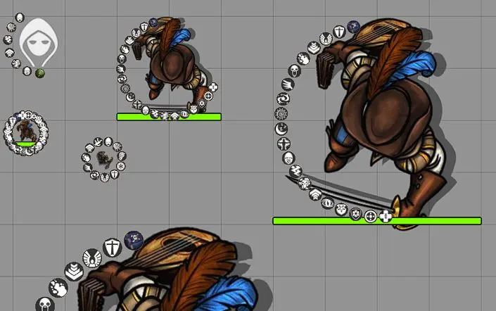

# Status Halo Continued

Arrange status icons around the edge of a token. Foundry continues to handle effect visibility, tints, image loading, and centered overlay icons.

This is a community continuation of [Status Halo by mxzf](https://gitlab.com/mxzf/status-halo), with the original Git history and MIT license preserved. The original idea and underlying code came from [PF2e Dorako UI by Dorako](https://foundryvtt.com/packages/pf2e-dorako-ui).

**Development build.** The current target is Foundry VTT 14.369 with Pathfinder 2e 8.5.1. Live verification in that combination is pending. The manifest deliberately makes no `verified` compatibility claim.



## Install a development build locally

Use a test world or a backup of your world for the first test.

1. Run `python create_release.py module` from this repository. On Windows, use `py -3.12 create_release.py module` if necessary.
2. Stop Foundry. Extract `dist/status-halo-continued-0.2.0-dev.1.zip` into `<Foundry user data>/Data/modules/status-halo-continued/`.
3. Check that `module.json` is directly inside that folder.
4. Start Foundry and open the test world. Disable the original Status Halo and other modules that rearrange status icons.
5. Enable **Status Halo Continued** in **Manage Modules** and reload the world.

The new module ID lets you keep the original installed. Enable only one of them at a time. To roll back, disable Status Halo Continued and reload. This module changes presentation and does not migrate world data.

No GitHub release is published yet. The manifest's release URLs are reserved for future releases and do not currently provide an installer. A repository source ZIP also includes development files; use the packaged ZIP above when you install the module.

## Test the Foundry 14 build

Record your Foundry build, game system version, and enabled modules. Open the browser console before you test and retain any errors.

- Add and remove several PF2e conditions, then remove all conditions. Check that icons and their backgrounds disappear together.
- Set an overlay with ordinary conditions present. Check that the overlay stays centered, large, and unmasked while the conditions form a halo.
- Display a permanent effect, hide an effect icon, and test an effect with a tint. Foundry's icon visibility and tint must remain intact.
- Test small, normal, large, and rectangular tokens. Check that the halo stays centered after a resize.
- Reload the world, switch scenes, and add or remove effects again. Check for duplicate icons and console errors.
- Re-enable your normal modules in small groups. Other modules that change effect layout can conflict.

For a bug report, include the steps, expected result, actual result, and console error. Remove private server details from any console output before posting it publicly.

## Run local checks

Node.js 24 or newer and Python 3.12 or newer are sufficient. There are no project dependencies to install.

```sh
node --check main.js
node --test
python -m unittest discover -s tests -p 'test_*.py'
python create_release.py module
```

Automated checks cover the rendering contract and packaging. They do not prove visual compatibility in a running Foundry world.

## Publish a tested release

After live verification, set the version and verified build in `module.json` and update the changelog. Run the local checks and rebuild the archive. Create a GitHub release tagged `v<version>` and attach `dist/module.json` and the ZIP from `dist/`. Mark test releases as prereleases.

The stable manifest URL is reserved for the first tested, non-prerelease GitHub release:

```text
https://github.com/tom-l-mot/status-halo-continued/releases/latest/download/module.json
```

Once that release exists, users can paste this URL into Foundry's module installer. Listing the module in Foundry's package directory is a separate step after release testing.

## Credits and license

- mxzf created Status Halo. The upstream history also records contributions from Larkinabout.
- Dorako created the original PF2e Dorako UI idea and code credited by upstream.
- tom-l-mot maintains this continuation.

The code remains under the [MIT license](LICENSE). Preserve the original copyright and permission notice when you redistribute it. Foundry VTT itself is proprietary and is not included in this repository.
