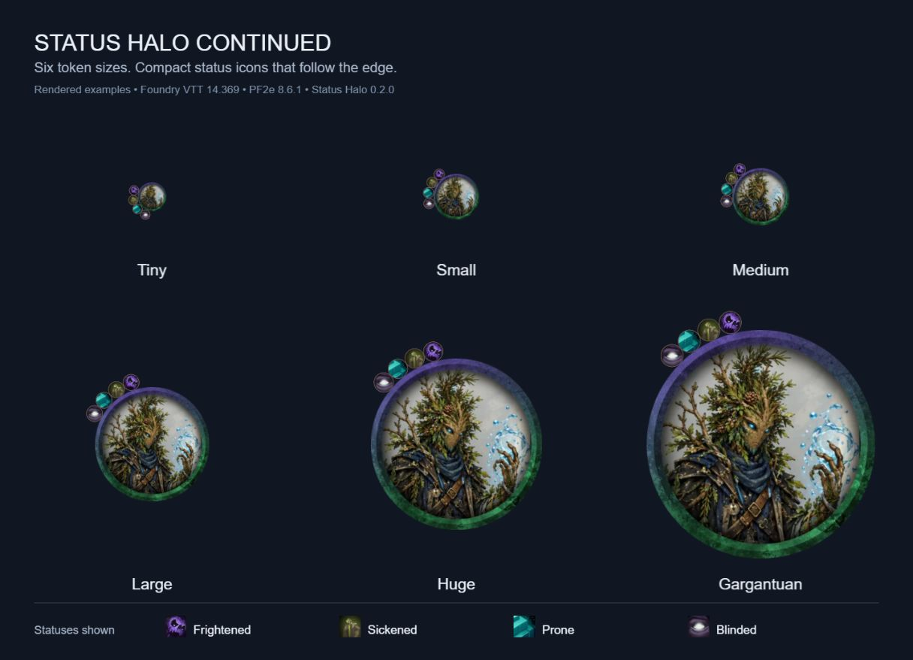

# Status Halo Continued

[](#install-in-foundry)
[](#system-compatibility)
[](https://github.com/tom-l-mot/status-halo-continued/releases/latest)
[](LICENSE)
[](https://ko-fi.com/tomlmot)
[](https://www.patreon.com/TheOpenTableWorkshop)

Arrange compact, circular status icons around the edge of a token, with gentle scaling across token sizes. Foundry continues to handle effect visibility, tints, image loading, and centered overlay icons.



*Staged size comparison rendered with Status Halo Continued 0.2.0 and PF2e status icons. The same artwork is shown at each size, including PF2e's smaller artwork scale for Small tokens.*

This is a community continuation of [Status Halo by mxzf](https://gitlab.com/mxzf/status-halo), with the original Git history and MIT license preserved. The original idea and underlying code came from [PF2e Dorako UI by Dorako](https://foundryvtt.com/packages/pf2e-dorako-ui).

The renderer uses Foundry's token and effect data without checking the game system. Status Halo Continued is system agnostic. Live compatibility checks have passed in the systems listed below. The manifest sets no Foundry version limits and retains Foundry 14.369 as its verified version. Other Foundry versions remain untested.

Custom artwork with transparent margins or off-center anchors may need adjustment. Very crowded halos can overlap when there is insufficient space.

## System compatibility

| Game system | Version | Foundry VTT | Status |
| --- | --- | --- | --- |
| Pathfinder 2e | 8.6.1 | 14.369 | Passed |
| D&D 5e | 6.0.6 | 14.369 | Passed |
| Starfinder 2e | 1.6.1 | 14.369 | Passed |

Other systems are unverified. These checks cover native conditions, rendered placement, token sizes, overlays, reloads, and scene changes in dedicated test worlds. See the [compatibility record](documentation/compatibility.md) for exact coverage and limits. PF2e and Starfinder 2e apply Off-Guard when the tested NPC becomes Prone.

## Install in Foundry

Open Foundry's **Add-on Modules**, choose **Install Module**, and paste this manifest URL:

```text
https://github.com/tom-l-mot/status-halo-continued/releases/latest/download/module.json
```

This URL requires the published GitHub release assets. If no release is available, use the local build instructions below.

Open your world and disable the original Status Halo and other modules that rearrange status icons. Enable **Status Halo Continued** in **Manage Modules** and reload the world.

The new module ID lets you keep the original installed. Enable only one of them at a time. To roll back, disable Status Halo Continued and reload. This module changes presentation and does not migrate world data.

## Install a local build

Use a test world or a backup of your world for the first test.

1. Run `python create_release.py module` from this repository. On Windows, use `py -3.12 create_release.py module` if necessary.
2. Stop Foundry. Extract `dist/status-halo-continued-0.2.2.zip` into `<Foundry user data>/Data/modules/status-halo-continued/`.
3. Check that `module.json` is directly inside that folder.
4. Start Foundry and open the test world. Disable the original Status Halo and other modules that rearrange status icons.
5. Enable **Status Halo Continued** in **Manage Modules** and reload the world.

A repository source ZIP also includes development files. Use the packaged ZIP above when you install the module.

## Test the Foundry 14 build

Use a dedicated test world. Record your Foundry build, game system version, and enabled modules. Open the browser console before you test and retain any errors.

- Add and remove native conditions, then remove all conditions. Check that icons and their backgrounds disappear together.
- Set a native overlay with ordinary conditions present. Check that the overlay stays centered, large, and unmasked while the conditions form a halo.
- Display a permanent effect, hide an effect icon, and test an effect with a tint. Foundry's icon visibility and tint must remain intact.
- Test Tiny, Small, Medium, Large, Huge, Gargantuan, and rectangular tokens. Check that the halo follows the rendered edge after a resize, including Small tokens and dynamic rings.
- Reload the world, switch scenes, and add or remove effects again. Check for duplicate icons and console errors.
- Re-enable your normal modules in small groups. Other modules that change effect layout can conflict.

For PF2e and Starfinder 2e, account for system-added effects such as Off-Guard when Prone is active. For a bug report, include the steps, expected result, actual result, and console error. Remove private server details from any console output before posting it publicly.

## Run local checks

Node.js 24 or newer and Python 3.12 or newer are sufficient. There are no project dependencies to install.

```sh
node --check main.js
node --test
python -m unittest discover -s tests -p 'test_*.py'
python create_release.py module
```

Automated checks cover effect visibility, tints, overlays, mask cleanup, token sizing, compact spacing, dynamic rings, and packaging. Live visual checks remain separate from these tests.

## Publish a tested release

Run the local checks and rebuild the archive. For version 0.2.2, create a non-prerelease GitHub release tagged `v0.2.2` and attach `dist/module.json` and `dist/status-halo-continued-0.2.2.zip`. The stable manifest URL then points to that release. Listing the module in Foundry's package directory is a separate step.

## Credits and license

- mxzf created Status Halo. The upstream history also records contributions from Larkinabout.
- Dorako created the original PF2e Dorako UI idea and code credited by upstream.
- tom-l-mot maintains this continuation.

The code remains under the [MIT license](LICENSE). Preserve the original copyright and permission notice when you redistribute it. Foundry VTT itself is proprietary and is not included in this repository.

## Support development

If you'd like to support continued development and maintenance, you can [buy me a coffee on Ko-fi](https://ko-fi.com/tomlmot). Thanks for your support!
